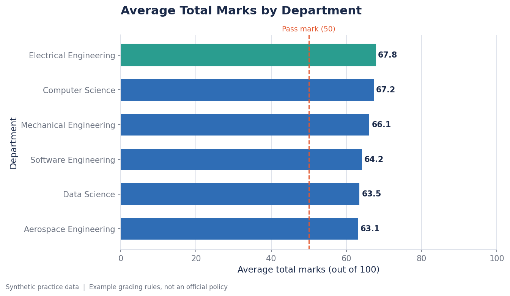
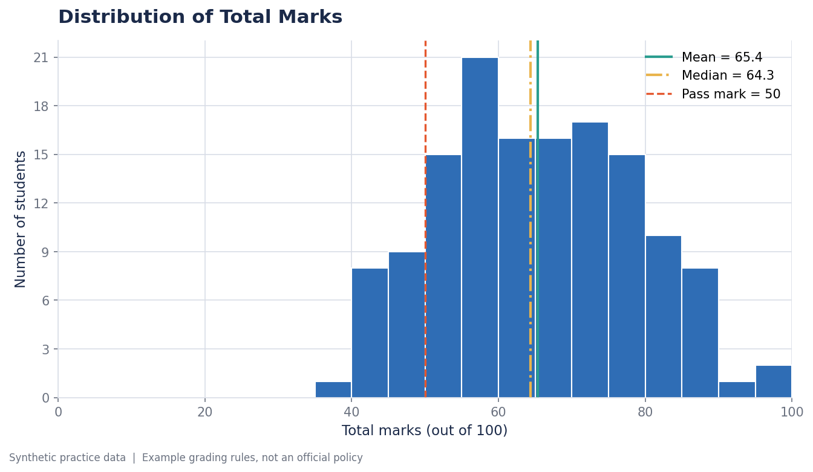
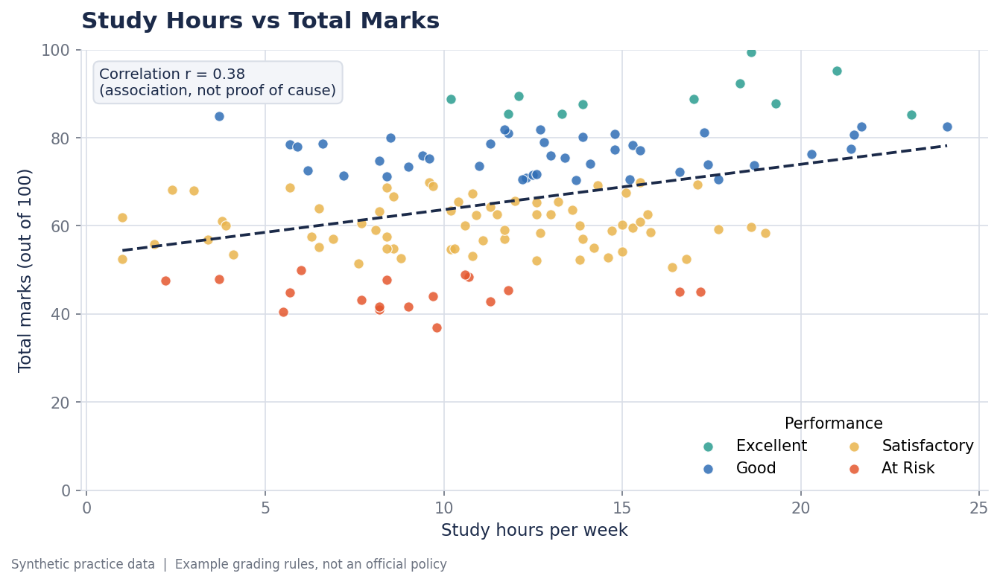
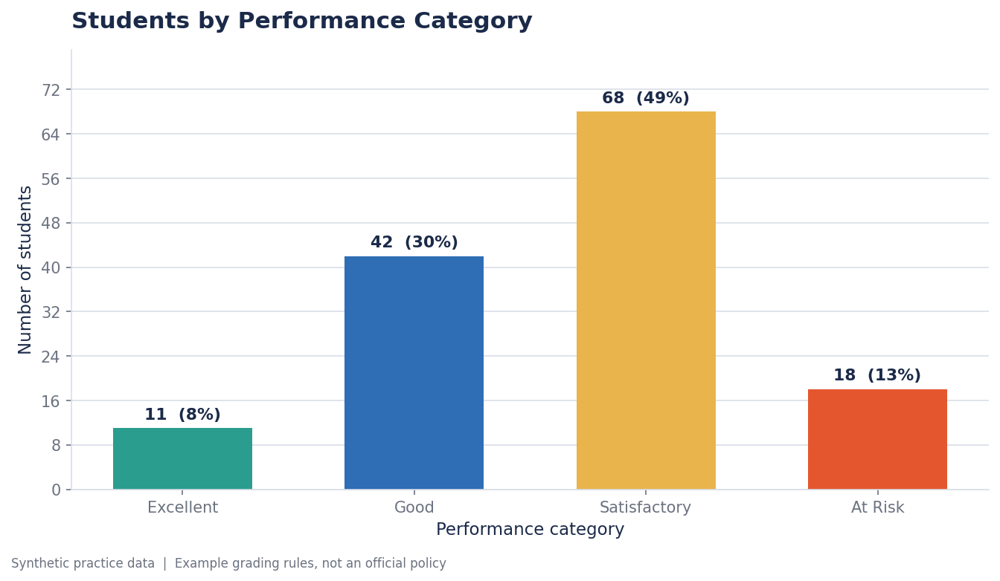
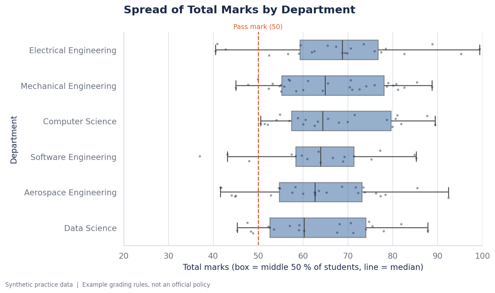
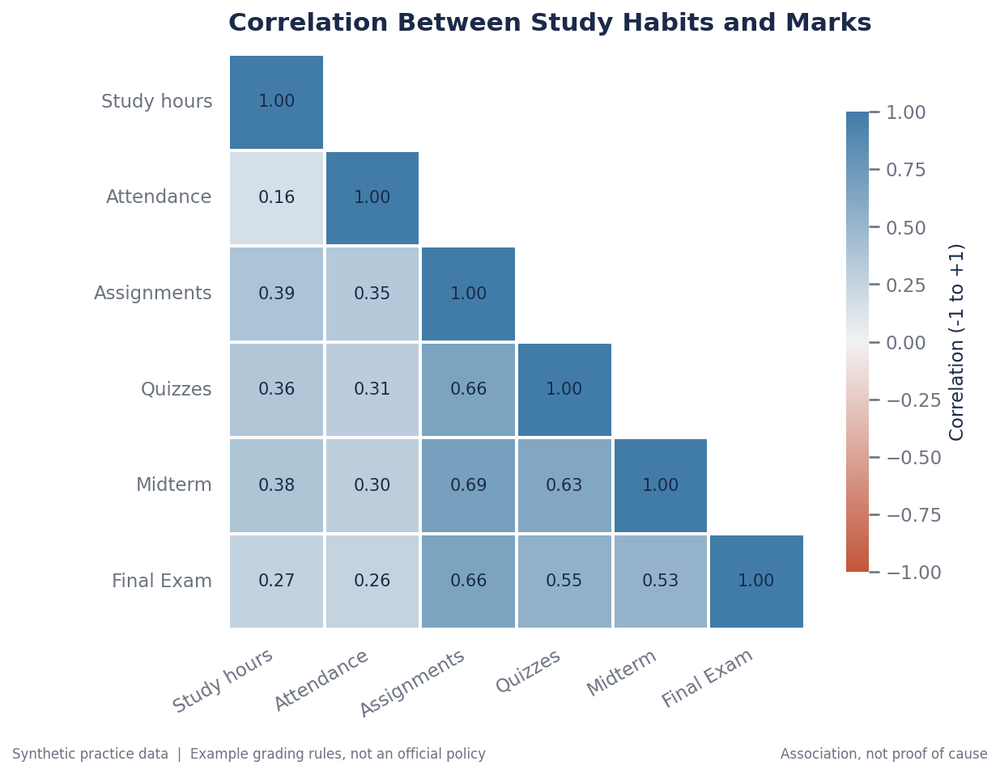
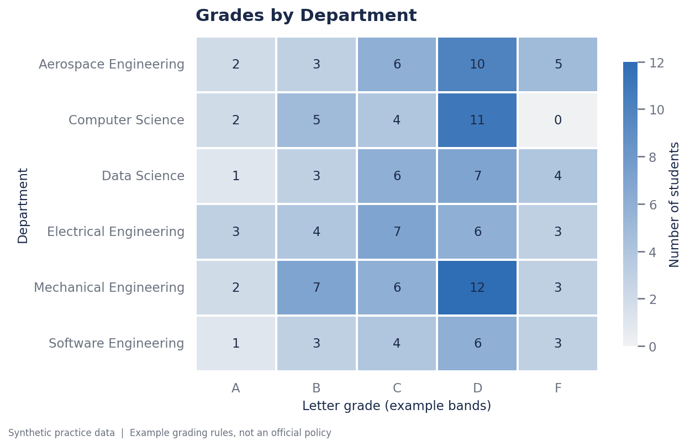
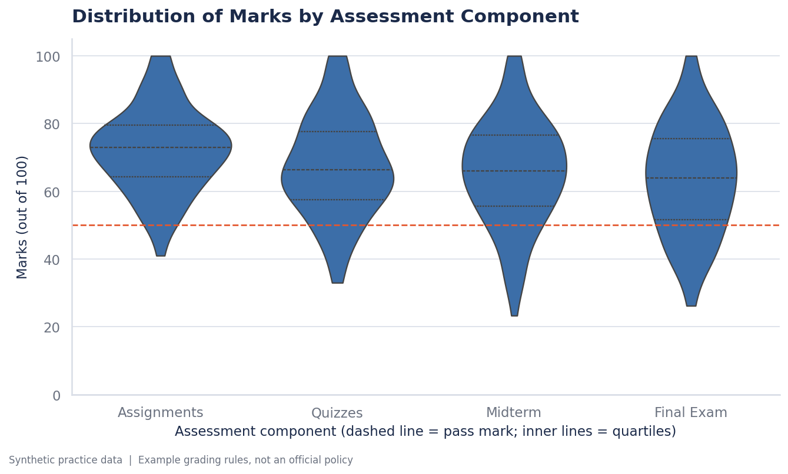
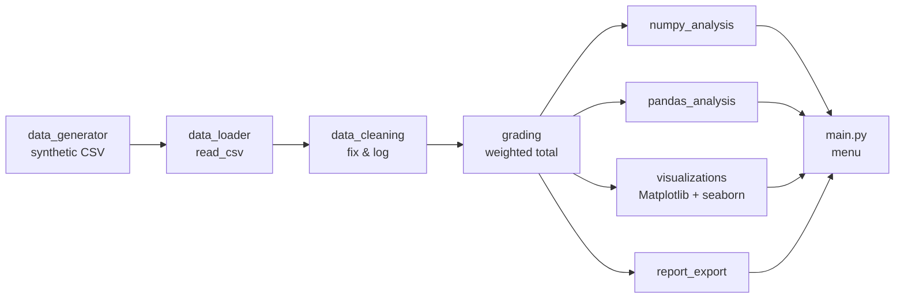

<div align="center">

# 🎓 Student Performance & Data Analytics System

**A beginner-friendly, professionally structured data-analysis project built with Python, NumPy, Pandas, Matplotlib and seaborn.**




</div>

---

## Table of contents

1. [Project overview](#1-project-overview)
2. [Features](#2-features)
3. [Technologies used](#3-technologies-used)
4. [Prerequisites](#4-prerequisites)
5. [Installation on Windows 11 + VS Code](#5-installation-on-windows-11--vs-code)
6. [How to run](#6-how-to-run)
7. [Example session and outputs](#7-example-session-and-outputs)
8. [Project structure](#8-project-structure)
9. [The data-analysis workflow](#9-the-data-analysis-workflow)
10. [Configuration](#10-configuration)
11. [Running the tests](#11-running-the-tests)
12. [Troubleshooting](#12-troubleshooting)
13. [Known limitations](#13-known-limitations)
14. [Ideas for future improvements](#14-ideas-for-future-improvements)

> 📘 **New to the code?** Read [`docs/LEARNING_GUIDE.md`](docs/LEARNING_GUIDE.md). It explains every module in plain language, shows sample inputs/outputs, lists common errors, and gives you exercises.

---

## 1. Project overview

This application analyses the academic performance of students. It:

1. **creates** a synthetic (fake, non-confidential) dataset of 155 records that is *deliberately messy*;
2. **cleans** it, explaining every decision instead of silently changing data;
3. **calculates** weighted grades with a configurable grading scheme;
4. **analyses** the results with NumPy and Pandas;
5. **visualises** them with eight charts (Matplotlib for the basics, seaborn for statistical charts); and
6. **exports** professional CSV reports.

Everything is driven from a colourful, menu-based command-line interface. It needs **no internet, no paid API, no database and no machine-learning library** after installation.

> ⚠️ **Disclaimer:** All student data is randomly generated. The grading bands, pass mark and thresholds are **example rules for practice**, not an official policy of NUST, NESCOM or any university.

## 2. Features

| # | Feature | Where |
|---|---------|-------|
| 1 | Synthetic dataset (fixed seed → reproducible), saved to CSV, loaded with `pandas.read_csv()`; head, shape, columns, dtypes, summary statistics, Series-vs-DataFrame demo | `data_generator.py`, `data_loader.py` |
| 2 | Cleaning: missing values, duplicates, invalid ranges, type conversion, label standardisation, before/after summary, a log that explains **every** decision | `data_cleaning.py` |
| 3 | NumPy analysis: mean, median, min, max, std, variance, percentiles, boolean masks, `np.unique(..., return_counts=True)`, array arithmetic, speed test | `numpy_analysis.py` |
| 4 | Configurable weighted grading (10 / 10 / 30 / 50), validation, grade bands, performance categories, pass/fail | `grading.py`, `config.py` |
| 5 | Pandas analysis: top/bottom 10, group statistics, pass rate, attendance flags, correlation (with a causation warning) using `groupby`, `agg`, `sort_values`, `value_counts`, `loc`, `query`, `merge` | `pandas_analysis.py` |
| 6 | Eight themed charts saved as PNG: four Matplotlib (bar, histogram, scatter, category bar) and four seaborn (box plot, correlation heatmap, department-by-grade heatmap, violin plot) | `visualizations.py`, `statistical_charts.py` |
| 7 | Five CSV reports + a cleaning log | `report_export.py` |
| 8 | Menu-driven CLI with input validation and friendly errors | `main.py`, `ui.py` |
| ✔ | 69 automated `unittest` tests | `tests/` |

### Chart gallery

<table>
<tr>
<td></td>
<td></td>
</tr>
<tr>
<td colspan="2" align="center"></td>
</tr>
</table>

**seaborn statistical charts**

<table>
<tr>
<td></td>
<td></td>
</tr>
<tr>
<td></td>
<td></td>
</tr>
</table>

## 3. Technologies used

| Technology | Role in this project |
|-----------|----------------------|
| **Python 3.10+** | Main language |
| **NumPy** | Fast numerical work: statistics, percentiles, boolean masks, `np.unique`, matrix product for weighted totals |
| **Pandas** | Loading, cleaning, filtering, grouping, aggregating, merging, exporting |
| **Matplotlib** | The drawing engine: bar chart, histogram, scatter plot with trend line |
| **seaborn** | Statistical charts built on Matplotlib: box plot, violin plot, annotated heatmaps (`pd.crosstab` and correlation matrix) |
| **CSV** | Input and output format |
| **unittest** | Built-in test framework (nothing extra to install) |

No scikit-learn, no frameworks, no databases: you master data manipulation first.

## 4. Prerequisites

* Windows 11 (the code is also fine on macOS and Linux)
* **Python 3.10 or newer**, from [python.org](https://www.python.org/downloads/). During installation tick **"Add python.exe to PATH"**.
* **Visual Studio Code** with the official **Python** extension (by Microsoft)
* About 150 MB of disk space for the libraries

Check Python in a terminal:

```powershell
python --version
```

## 5. Installation on Windows 11 + VS Code

### Step 1: Open the project

1. Unzip `student-performance-analytics.zip` somewhere simple, for example `C:\Projects\`.
2. In VS Code choose **File → Open Folder…** and select the `student-performance-analytics` folder.
3. Open the built-in terminal with **Ctrl + `** (PowerShell is fine).

### Step 2: Create a virtual environment

A virtual environment keeps this project's libraries separate from everything else on your computer.

```powershell
python -m venv .venv
```

### Step 3: Activate it

```powershell
.venv\Scripts\Activate.ps1
```

Your prompt now starts with `(.venv)`.

<details>
<summary>PowerShell says "running scripts is disabled"?</summary>

Run this once, then activate again:

```powershell
Set-ExecutionPolicy -Scope CurrentUser -ExecutionPolicy RemoteSigned
```

Or use Command Prompt instead: `.venv\Scripts\activate.bat`
</details>

### Step 4: Install the dependencies

```powershell
python -m pip install --upgrade pip
pip install -r requirements.txt
```

### Step 5: Tell VS Code to use the environment

Press **Ctrl + Shift + P → "Python: Select Interpreter"** and choose the one inside `.venv`. VS Code will now use the right Python for running and for autocomplete.

## 6. How to run

From the project folder, with the environment activated:

```powershell
python src\main.py                 # interactive menu (recommended)
python src\main.py --pipeline      # run every stage once, no questions asked
python src\main.py --regenerate    # create a fresh synthetic dataset, then open the menu
python src\main.py --debug         # show full error tracebacks (useful when learning)
```

A recommended first run through the menu: **1 → 3 → 4 → 5 → 6 → 7 → 8**.

| Menu | What it does |
|------|--------------|
| 1 | Dataset information: head, shape, columns, dtypes, statistics, Series vs DataFrame |
| 2 | View records: first N, search by name/ID, filter by department or semester |
| 3 | Clean the dataset (with a full explanation and before/after table) |
| 4 | NumPy statistical analysis (each operation explained: input, output, purpose, why NumPy) |
| 5 | Performance reports: top/bottom 10, pass/fail, attendance, study hours + correlation matrix, **settings** (change weights & thresholds) |
| 6 | Department and semester analysis, plus a grades-by-department crosstab |
| 7 | Create all eight charts (optionally open them in windows) |
| 8 | Export the CSV reports |
| 9 | Exit  (`g` = generate a new dataset) |

## 7. Example session and outputs

### Automatic pipeline

```text
$ python src\main.py --pipeline

▌ Automatic pipeline
──────────────────────────────────────────────────────────────────────────────
  ✔ Loaded 155 rows from students.csv
  ✔ Cleaned: 155 raw rows -> 139 clean rows
  ✔ Average total 65.4; pass rate 87.1%
  ✔ Saved 8 charts -> ...\output\charts
  ✔ Exported 6 files -> ...\output\reports
```

### Menu option 3: cleaning (excerpt)

```text
  Step 2: Standardised department labels - 20 value(s) changed (e.g. 'cs' /
          'COMPUTER SCIENCE' -> 'Computer Science').
  Step 4: Removed 5 duplicate record(s) (5 exact copies). We keep the FIRST
          occurrence because a student must be counted once.
  Step 5: 1 impossible value(s) in 'final_marks' (valid range 0-100; e.g.
          STU-0126=105) were treated as missing. We do not clip them because
          we cannot know the true value.
  Step 7: Filled 5 missing 'assignment_marks' value(s) with the median of the
          student's department group (median ignores extreme values).

  Before vs after
                       Check  Before  After
                        Rows     155    139
  Missing values (all cells)      29      0
              Duplicate rows       5      0
  Out-of-range values              7      0
  Distinct department labels      21      6
```

### Menu option 5 → 1: top students

```text
  Top 10 students by total marks
   rank       id          name             department  total grade
      1 STU-0140 Zain Chaudhry Electrical Engineering  99.40     A
      2 STU-0031    Omar Iqbal Electrical Engineering  95.25     A
      3 STU-0058 Usman Hussain  Aerospace Engineering  92.41     A
```

### Files created in `output/`

```text
output/
├── charts/
│   ├── department_average_marks.png
│   ├── total_marks_distribution.png
│   ├── study_hours_vs_marks.png
│   ├── performance_categories.png
│   ├── department_boxplot.png          (seaborn)
│   ├── correlation_heatmap.png         (seaborn)
│   ├── department_grade_heatmap.png    (seaborn)
│   └── assessment_distributions.png    (seaborn)
└── reports/
    ├── cleaned_students.csv            trusted input for further analysis
    ├── student_performance_report.csv  one row per student: total, grade, rank
    ├── department_statistics.csv       department comparison
    ├── low_attendance_students.csv     follow-up list
    ├── top_students.csv                top 10
    └── cleaning_log.txt                every cleaning decision, in words
```

CSV files open directly in Excel or Google Sheets (they are saved as UTF-8 with a BOM so Excel on Windows reads them correctly) or can be reloaded with `pandas.read_csv()`.

## 8. Project structure

```text
student-performance-analytics/
├── data/
│   └── students.csv              synthetic raw dataset (messy on purpose)
├── output/                       charts/ and reports/ are created here
├── src/
│   ├── main.py                   menu + printing (no heavy logic)
│   ├── config.py                 ALL settings: paths, weights, thresholds, colours
│   ├── ui.py                     terminal theme: colours, banners, safe input
│   ├── data_generator.py         builds the synthetic dataset
│   ├── data_loader.py            read_csv + friendly errors + dataset overview
│   ├── data_cleaning.py          cleaning pipeline that logs every decision
│   ├── grading.py                weights, validation, grades, categories
│   ├── numpy_analysis.py         NumPy statistics and array operations
│   ├── pandas_analysis.py        groupby / agg / query / merge analyses
│   ├── visualizations.py         four core Matplotlib charts + shared theme
│   ├── statistical_charts.py     four seaborn charts (box, heatmaps, violin)
│   └── report_export.py          CSV report export
├── tests/                        69 unittest tests (+ small hand-made datasets)
├── docs/
│   ├── LEARNING_GUIDE.md         module-by-module teaching notes and exercises
│   └── images/                   charts used in this README
├── requirements.txt
└── README.md
```

This follows the structure you asked for, plus five small additions: `config.py` (so numbers are never hard-coded in several places), `ui.py` (keeps `main.py` readable), `grading.py` (grading deserves its own module because Feature 4 is a topic by itself), `statistical_charts.py` (seaborn charts live apart from the core Matplotlib ones) and `tests/`.

## 9. The data-analysis workflow



**Design rules that keep the project reliable**

* **No data leakage.** Every stage works on a *copy* (`df.copy()`); the raw data in memory and the CSV on disk are never changed. A test proves it.
* **Nothing changes silently.** Every cleaning step writes a sentence to a log, shown in the menu and saved to `cleaning_log.txt`.
* **One scale.** Every mark is 0–100 and the weights add up to 1.0, so totals are 0–100. Validation raises a clear error otherwise.
* **Pure functions.** Analysis functions take data in and return results; only `main.py` prints. That makes them easy to test.
* **Reproducible.** A fixed random seed (`42`) creates identical data on every computer.

## 10. Configuration

Open `src/config.py` to change behaviour without touching any logic:

| Setting | Default | Meaning |
|---------|---------|---------|
| `GRADE_WEIGHTS` | 10 / 10 / 30 / 50 % | Assignments, quizzes, midterm, final (must total 100 %) |
| `GRADE_BANDS` | A ≥ 85, B ≥ 75, C ≥ 65, D ≥ 50, else F | Example letter grades |
| `PERFORMANCE_BANDS` | Excellent ≥ 85, Good ≥ 70, Satisfactory ≥ 50, At Risk | Used in charts |
| `PASS_THRESHOLD` | 50 | Example pass mark |
| `LOW_ATTENDANCE_THRESHOLD` | 75 % | Flags low attendance |
| `NUM_STUDENTS`, `RANDOM_SEED` | 150, 42 | Dataset size and reproducibility |

Weights and thresholds can also be changed **at run time** in menu **5 → 8**.

## 11. Running the tests

```powershell
python -m unittest discover -s tests -t . -v
```

The tests check weighted-total arithmetic (e.g. 0.10·80 + 0.10·70 + 0.30·60 + 0.50·90 = 78), grade boundaries, weight validation, every cleaning rule, NumPy statistics, pandas group statistics, the seaborn helper tables, chart creation (all eight files saved, titles and axis labels present), loader error messages, reproducibility, no-leakage, and a complete generate → clean → grade → export run.

## 12. Troubleshooting

| Problem | Fix |
|---------|-----|
| `'python' is not recognized` | Reinstall Python and tick **Add to PATH**, or try `py` instead of `python`. |
| `ModuleNotFoundError: No module named 'seaborn'` (or pandas, numpy, matplotlib) | The environment is not active. Run `.venv\Scripts\Activate.ps1`, then `pip install -r requirements.txt`. |
| Error appears only in menu 7 after upgrading | New libraries were added (seaborn). Run `pip install -r requirements.txt` again inside the activated environment. |
| `ModuleNotFoundError: No module named 'config'` | Start the app from the project folder with `python src\main.py`. |
| `FileNotFoundError ... students.csv` | Choose **Yes** when the menu offers to generate it, or run `python src\data_generator.py`. |
| `PermissionError` while exporting | Close the CSV in Excel, then export again. |
| Charts do not open in windows | The PNG files are still saved in `output\charts`. Open them from VS Code. |
| Strange symbols in the menu | Use Windows Terminal / the VS Code terminal. Set `NO_COLOR=1` to disable colours. |

## 13. Known limitations

* The dataset is synthetic: patterns (e.g. study hours ↔ marks) are built in, so conclusions do not transfer to real students.
* Imputation uses simple group medians; it is transparent but not statistically sophisticated.
* A correlation is shown, but no significance tests or confidence intervals.
* The CLI is single-user and keeps data in memory only.
* Grading bands and thresholds are examples, not an official policy.
* Large datasets (millions of rows) would need performance tuning.

## 14. Ideas for future improvements

* Load *your own* CSV (menu option to choose a file path) and add a column-mapping step.
* Export a polished Excel workbook (`openpyxl`) or a PDF summary report.
* Add pivot tables (`pd.pivot_table`) and `pd.crosstab` for gender × department.
* Add significance tests (SciPy) and simple confidence intervals.
* Build an interactive dashboard (Streamlit) on top of the same analysis modules.
* Only after mastering the basics: a first machine-learning model (e.g. predicting at-risk students) with scikit-learn.
* Add `pytest`, type hints and a CI workflow (GitHub Actions).

---

<div align="center">
Built as a learning project for data analysis · All data is synthetic · Grading rules are examples only
</div>
